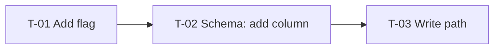

# Tasks: [Feature / Architecture Name]

**Source:** [path to local RFC]
**Project slug:** [short-kebab-name, used in branch names: `<username>/<project-slug>/<task-branch>`]
**Tracker:** [Linear / Jira / GitHub Issues project link, or "not published"]
**Generated:** [YYYY-MM-DD]
**Sizing:** every ticket is 1 story point (≤ 1 day, one PR, mergeable on its own). [Note any team-specific definition here.]

This is a local working file (untracked). When a ticket is published, the tracker is the source of truth for whether it exists and is wanted (e.g. canceled there means skip it); this file tracks the detailed delivery state.

**Statuses:** `open` → `in progress` → `pr-draft` → `pr-open` → `pr-ready` → `pr-merged` → `done`, plus `blocked` (with a reason) and `canceled` (no longer needed, with a reason).
- `pr-open`: PR is open for review; CI, review, or feedback still in progress.
- `pr-ready`: checks green, review finished, no unaddressed feedback; waiting to be merged.
- `pr-merged`: merged to main. `done`: merged and closed in the tracker (and any rollout step for it finished).
- **Spikes** (type `spike`) produce a decision, not a PR: `open` → `in progress` → `decision-proposed` → `decided` → `done`. `decided` means a human approved the decision; `done` means the backlog was refined from it. Run them with `/spike-task`.
- A ticket can start when it's `open` and its dependencies are `pr-merged` or `done` (or stackable on an open PR, see `/deliver-project`). A spike dependency must be `done`.

## Summary
- **Tickets:** [N] across [M] milestones ([S] spikes)
- **Ready to start now:** [T-01, T-03, …]
- **Critical path:** [T-01 → T-04 → T-07 → …]
- **Feature flag:** [flag name, or "none"]

## Dependency graph

---

## Milestone 1: [Walking skeleton — what's demonstrable at the end]

### T-01 · [Imperative title, e.g. "Add `orders.v2_enabled` feature flag"]
- **Status:** open
- **Tracker:** [ENG-123 — link, or "—" if not published]
- **Branch / PR:** — (for spikes: **Decision:** path to the decision record)
- **Type:** story | spike | chore
- **Question:** [spikes only: the one question to answer, and the time box]
- **Depends on:** none
- **Context:** [1–2 sentences on why, with the relevant RFC decision]
- **Scope:** [What to change, concretely]
- **Files:** `path/to/file.ts`, `path/to/test.ts`
- **Out of scope:** [What not to do here, if it's tempting]
- **Acceptance criteria:**
  - [ ] [Observable, checkable outcome]
  - [ ] [Tests cover …]
- **Notes:** [Gotchas, links, people to ask]

### T-02 · [...]

---

## Milestone 2: [...]

---

## Rollout & cleanup
[Flag ramp-up steps, monitoring tickets, removal of old path and flag]

## Open questions
- [Question that could change the breakdown, owner]
